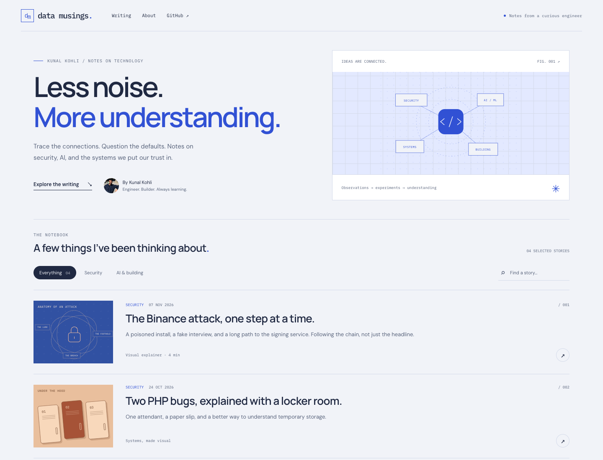
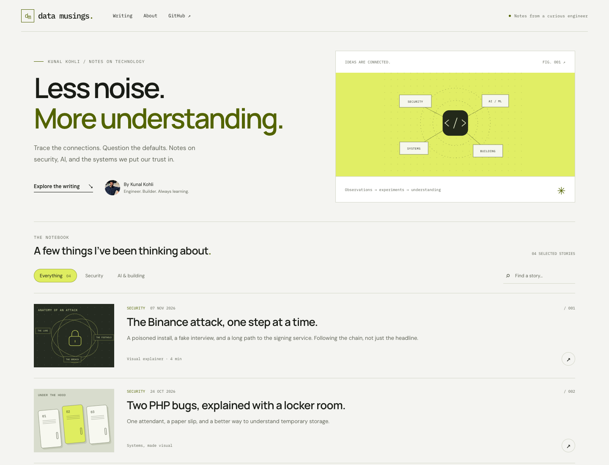
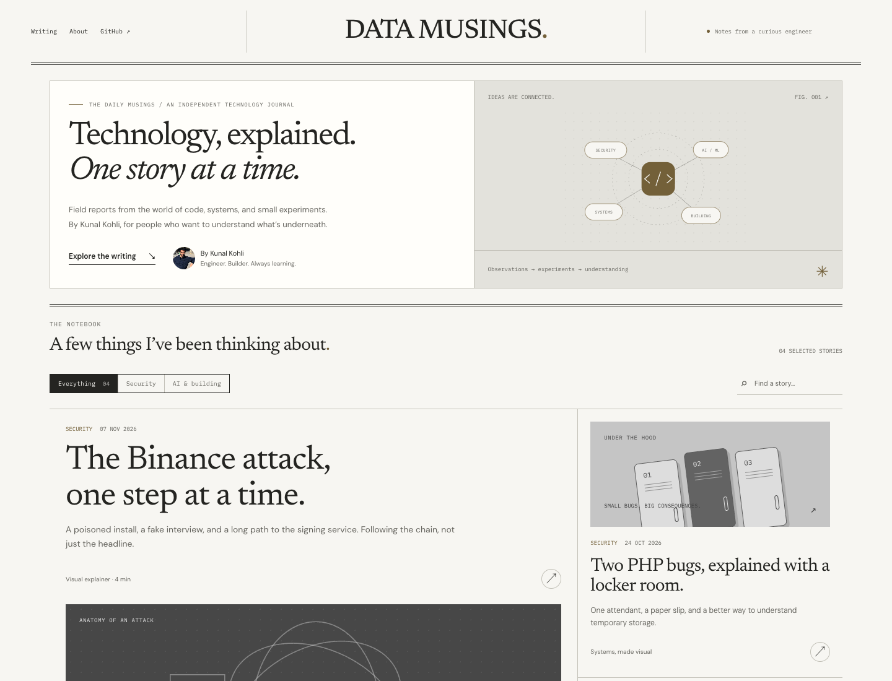
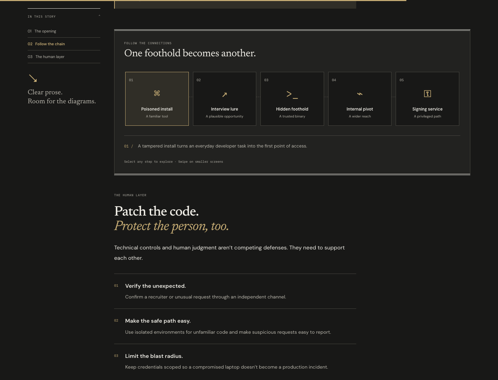
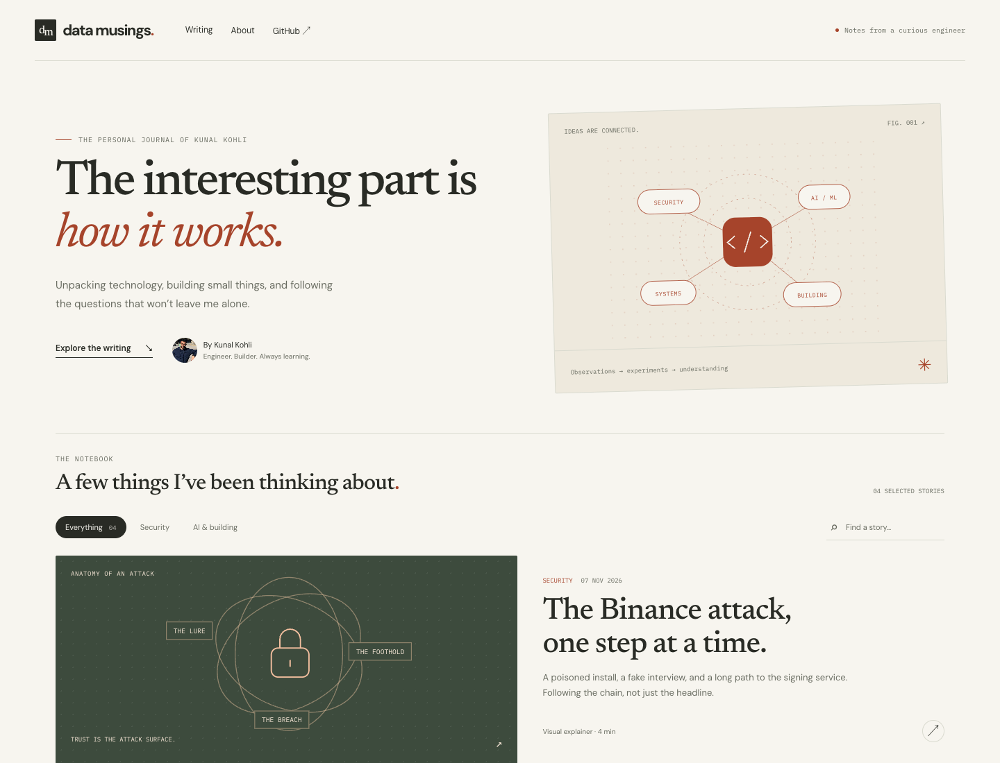
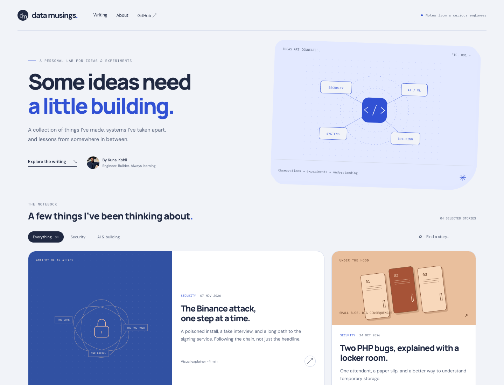
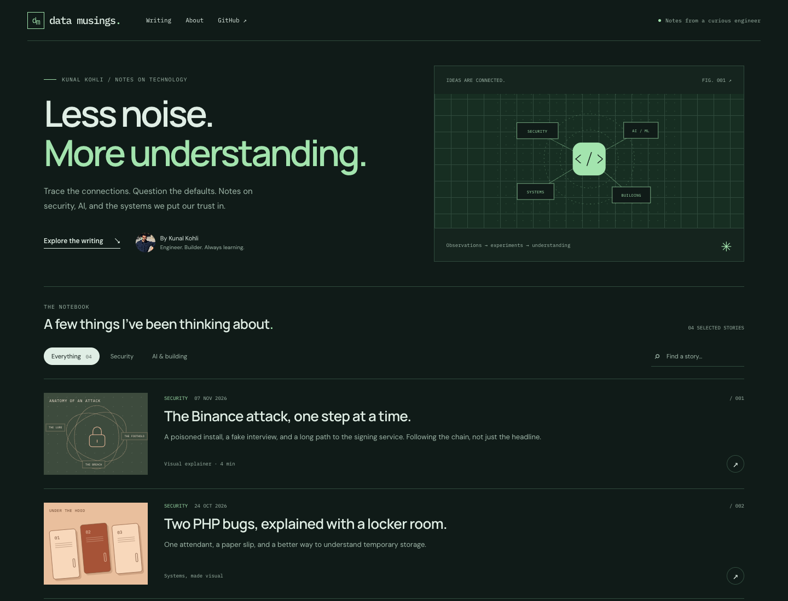
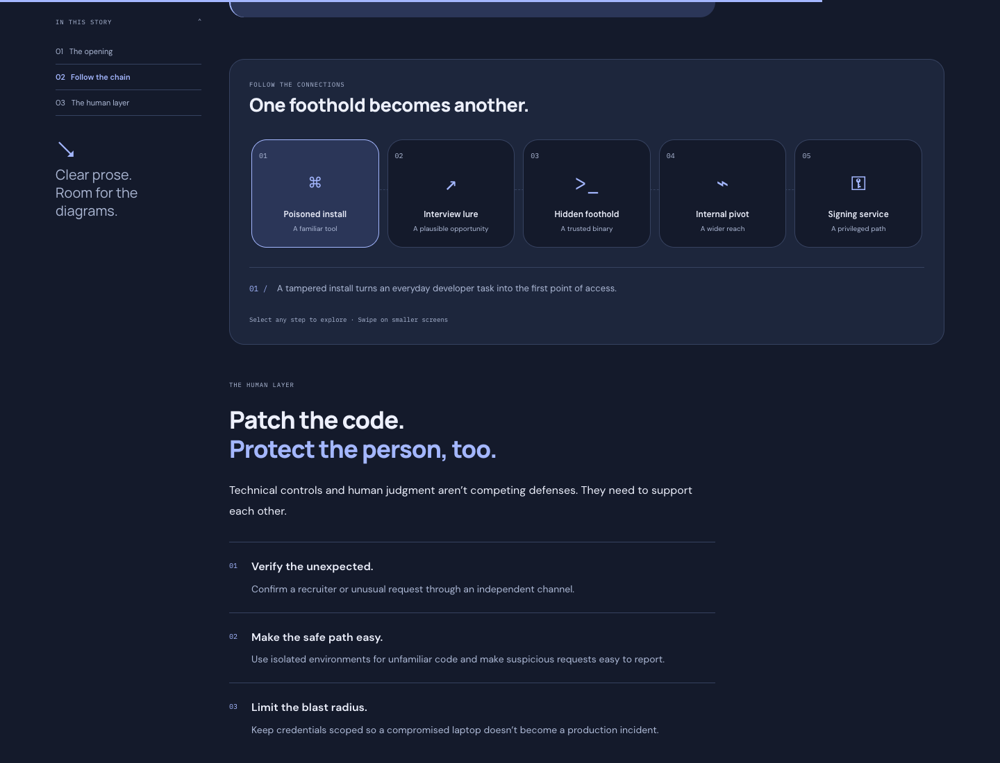

# Data Musings / design lab

Three standalone, interactive directions for review **before** redesigning the actual site. No production layouts, styles, post content, or navigation have been changed.

Open `/design-lab/` in a Jekyll build. The page is marked `noindex, nofollow`, and is intentionally not linked from the existing site.

## Updated shortlist: A / B / C

Open `/design-lab/?compare=signal&palette=workbench&theme=light` for the focused comparison requested after the original review:

| Option | Layout | Palette |
| --- | --- | --- |
| **A · Signal × Workbench** | Signal's compact technical index and persistent article contents rail | Workbench's blue/lavender, with midnight navy in dark mode |
| **B · Signal × Citrus** | Exactly the same layout as A | Bright lime/chartreuse, charcoal, off-white and muted sage, inspired by the supplied Ronas IT crypto-landing screenshot |
| **C · The Daily Musings** | Newspaper-style masthead, ruled columns, large lead story, grayscale artwork and serif headlines | Paper/charcoal with restrained sepia details; also includes dark mode |

Use `palette=citrus` or `palette=paper` for direct links to B/C; `view=article` previews the article. All three preserve a sticky article contents sidebar, a collapsible contents menu on mobile, reduced-motion support, and the theme toggle. Only A/B are palette-only variants; C deliberately explores a different layout.

The original three concepts remain available at `/design-lab/` without the comparison query parameters. The reference screenshots are interpreted as visual inspiration; their images and product UI are not copied into the blog.

| A · Signal × Workbench | B · Signal × Citrus | C · The Daily Musings |
| --- | --- | --- |
|  |  |  |



| Direction | Visual language | Best fit |
| --- | --- | --- |
| **01 Fieldnotes** | Warm paper/ink colors, expressive serif titles, editorial feature, asymmetric story grid | A writing-first journal with strong visual explainers. |
| **02 Workbench** | Rounded bento cards, bold sans-serif, colorful custom diagrams | A personal site giving projects and essays equal weight. Recommended for the requested modern, visual direction. |
| **03 Signal** | Compact story index, precise monospaced labels, diagram grid, green/ink palette | A technical notebook prioritizing scanning and systems thinking. |

Each direction has:

- Homepage and article-layout previews, both light and dark themes.
- Compact top navigation instead of the large fixed author sidebar.
- Readable article copy, a persistent sticky contents sidebar with active-section highlighting, and wide diagram breakouts alongside it. Mobile uses a collapsible sticky contents menu.
- Responsive layouts and keyboard-accessible controls.
- Subtle entrance/orbit animations, an optional interactive attack-chain player, and reduced-motion support.
- Working category filters, search of the four selected stories, About dialog, and reading-progress indicator.
- Shareable `?concept=fieldnotes&view=article&theme=dark` links. Concepts: `fieldnotes`, `workbench`, `signal`. Views: `home`, `article`. Themes: `light`, `dark`.
- A theme preference stored under a lab-only localStorage key; system preference is used until overridden.

The featured-story link opens the **illustrative article layout**, not a replacement for the actual Binance post. Other post links open the existing site in a new tab. All prose/diagrams in the article preview are sample content, clearly labeled as such.

## Review decision

Choose 01, 02, or 03 (or combine specific elements). Only after that choice should a separate implementation migrate the real homepage, post layouts, archive, category pages, and existing interactive diagrams. This PR is not that migration.

### Screenshots

| 01 / Fieldnotes | 02 / Workbench | 03 / Signal |
| --- | --- | --- |
|  |  |  |

All three have both themes; different themes are shown here to demonstrate the range.



## Local preview

Use the repository's normal Jekyll build. On the current machine, Bundler's pinned Nokogiri platform is incompatible, so the existing workaround is:

```sh
JEKYLL_NO_BUNDLER_REQUIRE=true "$HOME/.gem/ruby/2.6.0/bin/jekyll" build --destination /path/to/preview-build
python3 -m http.server 8795 --directory /path/to/preview-build
```

No npm build, framework migration, or runtime dependency is introduced. Fonts use Google Fonts with local system-font fallbacks. CSS and JavaScript are loaded only on the sandbox page.

## Inspiration references

The requested [Dribbble web UI gallery](https://dribbble.com/tags/web-ui) blocks direct access from this environment (HTTP 202 with an empty page). Search-index descriptions of these references informed the editorial hierarchy, compact contents rail, and modern card directions; the preview artwork and implementation are original, not copied assets:

- [Blog post — Untitled UI / Jordan Hughes](https://dribbble.com/shots/18288198-Blog-post-Untitled-UI) — minimal blog detail with a table of contents.
- [Sticky table of contents / Arun Venkatesan](https://dribbble.com/shots/14117570-Sticky-table-of-contents) — persistent in-article navigation.
- [Moxii — dark-mode blog and portfolio](https://dribbble.com/shots/27186719-Moxii-Dark-Mode-Blog-Portfolio-Platform-for-Designers-SaaS) — editorial dark palette and contrasting article cards.

## Regression checks

`scripts/test-design-lab.cjs` accepts a preview base URL, an installed Playwright module path, and an optional screenshot directory. Set `CHROME_PATH` if using installed Chrome. It checks three concepts × two themes × eight viewport widths × both pages, as well as filters/search, theme persistence, shareable URLs, article-chain controls, contents navigation, reduced motion, existing-site links, and browser errors.

`scripts/test-design-shortlist.cjs` uses the same arguments. It checks A/B/C in both themes across the same eight widths and page previews, verifies A/B geometry and typography are identical, and exercises the persistent/mobile contents and comparison URLs.
