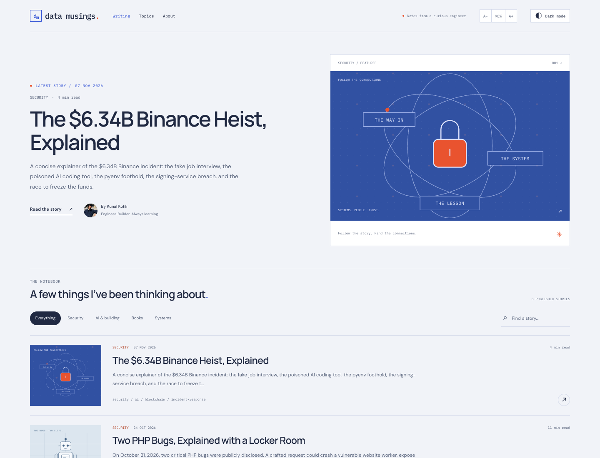
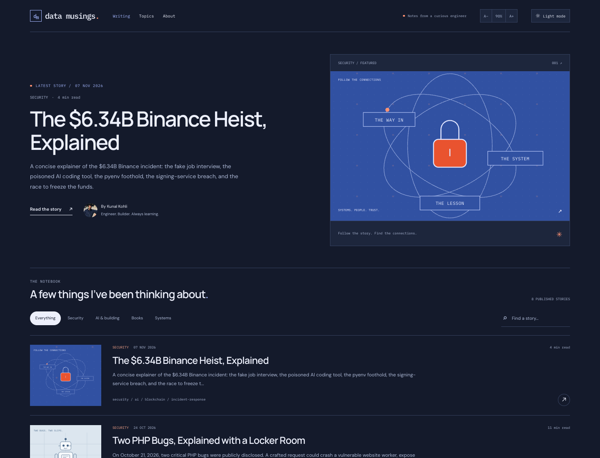
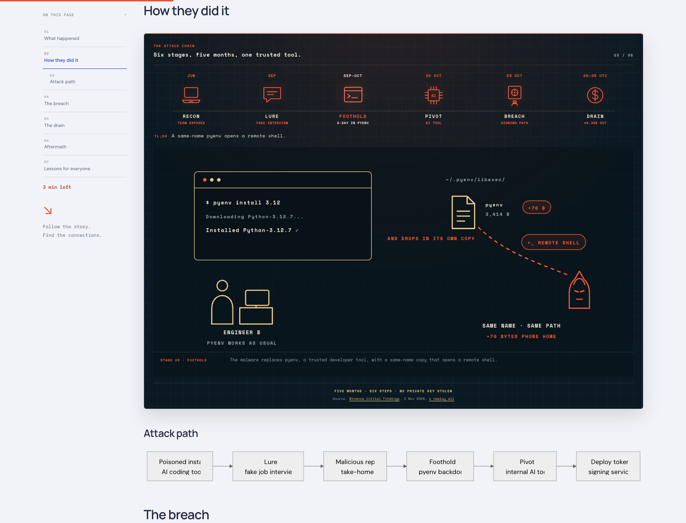
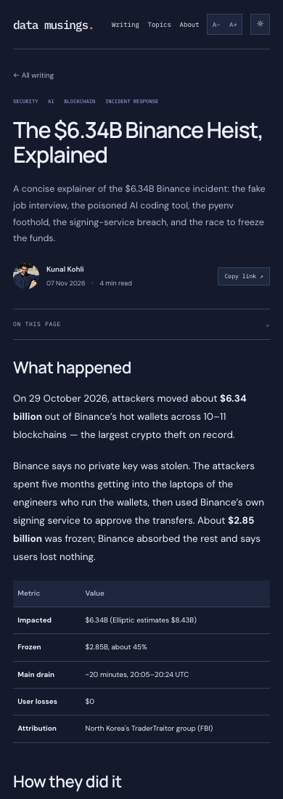

# Approved design implementation

Implements **A: Signal layout with Workbench colors**, following the design exploration in PR #44. Unlike that exploration, this is the actual Jekyll site, using the existing post content and routes. There is no sample article or replacement attack-chain widget.

## Homepage

The hero is automatically populated from the newest published post: title, date, categories, description/excerpt, read time, and link. A supplied feature image takes priority; otherwise a category-based SVG cover is used. The existing Binance post is currently newest, but nothing in the template pins that title or URL.

| Light | Dark |
| --- | --- |
|  |  |

## Original visual attack animation, retained

The post source, `_includes/binance-attack-animation.html`, `css/binance-attack.css`, and `js/binance-attack.js` are unchanged. The six original illustrated scenes, controls, stage TL;DRs and the authored Mermaid attack path remain inside the new article shell.

## Mobile article

## Verification

- All eight posts plus homepage/topics/archive/about/tags tested in light and dark mode at seven widths (320–2560px).
- Source-preservation assertion for all posts and original Binance animation assets.
- Original six scenes, stage switching, stage captions, keyboard controls, native no-JavaScript scene fallback, and contents links verified.
- Authored Mermaid label line breaks are retained when re-rendering for a new theme.
- Persistent desktop contents, collapsible sticky mobile contents, reading progress, search/filtering, internal links and legacy aliases verified.
- OS theme, saved preference, blocked storage, and no-JavaScript behavior verified.
- Existing PHP diagram tests pass at 320–3440px, including mouse/keyboard disclosure controls and all comic panels/tables.
- Isolated fixture builds prove the hero excludes unpublished/future posts and promotes a newly published post without touching the real posts.

See the root README for build, preview-server, and regression-test commands. Generated `_site/` output is intentionally not part of the PR.
